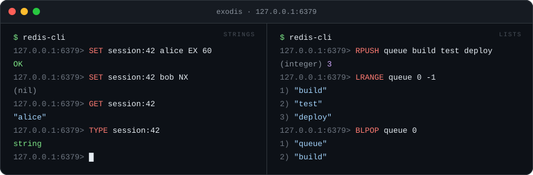
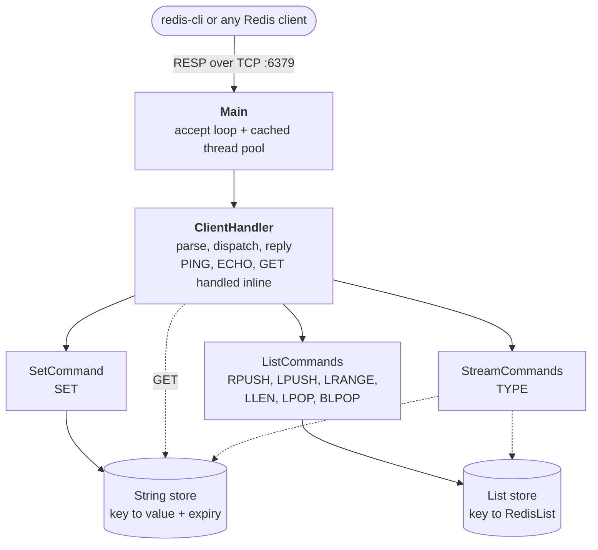
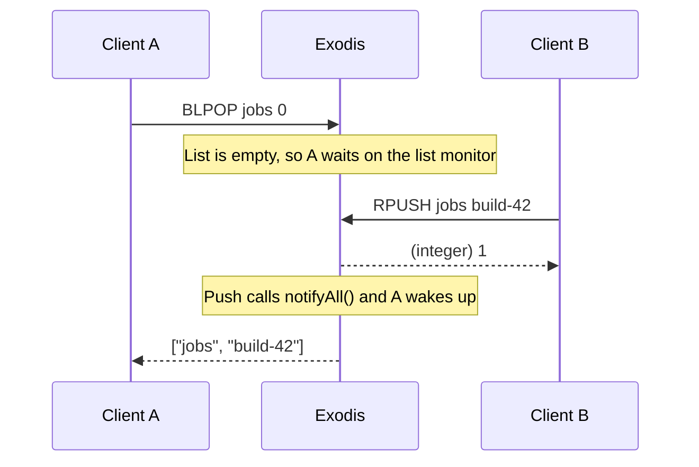

<div align="center">

# Exodis

**A multithreaded, Redis-compatible in-memory data store, written from scratch in Java.**


[Getting started](#getting-started) · [Commands](#commands) · [Architecture](#architecture) · [Project structure](#project-structure)



</div>

<br>

Exodis speaks the Redis serialization protocol (RESP) over TCP, so `redis-cli`
and standard Redis client libraries connect to it without any adapter. It
supports string keys with expiry and conditional writes, list operations, and
blocking pops shared across clients.

The server is multithreaded. Every client connection runs on its own worker
thread, and shared data is protected with concurrent maps, per-list locks, and
`wait`/`notifyAll` signaling between threads.

## Features

<table>
  <tr>
    <td width="50%" valign="top">
      <h4>Wire-compatible</h4>
      RESP parser and encoder written from scratch. Works with <code>redis-cli</code> and existing Redis clients.
    </td>
    <td width="50%" valign="top">
      <h4>Zero dependencies</h4>
      Built only on <code>java.net</code> sockets, <code>java.util.concurrent</code>, and Java's built-in monitors.
    </td>
  </tr>
  <tr>
    <td valign="top">
      <h4>Multithreaded server</h4>
      A thread pool serves each client on its own thread. Shared data is guarded by concurrent maps and per-list locks, so a client blocked in <code>BLPOP</code> never holds up anyone else.
    </td>
    <td valign="top">
      <h4>Complete <code>SET</code></h4>
      <code>NX</code>, <code>XX</code>, <code>GET</code>, <code>EX</code>, <code>PX</code>, <code>EXAT</code>, <code>PXAT</code>, and <code>KEEPTTL</code>, with millisecond-precision expiry.
    </td>
  </tr>
  <tr>
    <td valign="top">
      <h4>Linked-list storage</h4>
      Custom list with O(1) pushes at both ends and O(1) pops from the head.
    </td>
    <td valign="top">
      <h4>Blocking pops</h4>
      <code>BLPOP</code> with fractional-second timeouts, coordinated with <code>wait</code> and <code>notifyAll</code>.
    </td>
  </tr>
</table>

## Getting started

**Prerequisites**

- **JDK 25**, exactly. The build enables Java preview features, which only run
  when the compiler and runtime are the same release. If a newer JDK is your
  default, point `JAVA_HOME` (and `java` on your `PATH`) at a JDK 25 install.
- **Maven** 3.9 or newer.
- **redis-cli** (optional), for connecting to the server.

**1. Clone and build**

```bash
git clone https://github.com/Pramit3129/Exodis.git
cd Exodis
mvn -B compile
```

**2. Start the server**

```bash
java --enable-preview -cp target/classes Main
```

Or build and start in one step with `./your_program.sh`. The server listens on
port `6379`, so stop any local Redis instance first.

**3. Connect**

```console
$ redis-cli PING
PONG
```

## Commands

| Command | Syntax | Description |
| :-- | :-- | :-- |
| `PING` | `PING [message]` | Check the connection |
| `ECHO` | `ECHO message` | Return the given message |
| `SET` | `SET key value [NX \| XX] [GET] [EX s \| PX ms \| EXAT ts \| PXAT ts-ms \| KEEPTTL]` | Store a string value |
| `GET` | `GET key` | Read a string value |
| `TYPE` | `TYPE key` | Report the type stored at a key |
| `RPUSH` | `RPUSH key element [element ...]` | Append elements to a list |
| `LPUSH` | `LPUSH key element [element ...]` | Prepend elements to a list |
| `LRANGE` | `LRANGE key start stop` | Read a range of list elements |
| `LLEN` | `LLEN key` | Get the length of a list |
| `LPOP` | `LPOP key [count]` | Remove and return elements from the head |
| `BLPOP` | `BLPOP key timeout` | Like `LPOP`, but waits for an element |

Commands and options are case-insensitive. Expand a command below for its full
behavior.

<details>
<summary><b>PING</b> and <b>ECHO</b></summary>

<br>

`PING [message]` returns `PONG`, or `message` as a bulk string if one is given.

`ECHO message` returns `message` as a bulk string.

</details>

<details>
<summary><b>SET</b>: options, rules, and replies</summary>

<br>

```text
SET key value [NX | XX] [GET]
    [EX seconds | PX milliseconds |
     EXAT unix-time-seconds | PXAT unix-time-milliseconds | KEEPTTL]
```

Stores `value` at `key`, replacing any existing string value.

| Option | Description |
| :-- | :-- |
| `NX` | Only set the key if it does not already exist |
| `XX` | Only set the key if it already exists |
| `GET` | Return the previous value instead of `OK` |
| `EX seconds` | Expire after the given number of seconds |
| `PX milliseconds` | Expire after the given number of milliseconds |
| `EXAT unix-time-seconds` | Expire at the given Unix time, in seconds |
| `PXAT unix-time-milliseconds` | Expire at the given Unix time, in milliseconds |
| `KEEPTTL` | Keep the time to live already set on the key |

**Rules**

- Options can appear in any order.
- `NX` and `XX` can't be combined.
- Only one of `EX`, `PX`, `EXAT`, `PXAT`, and `KEEPTTL` can be used.
- `GET` can appear at most once.
- Expiry values must be positive integers. A timestamp in the past is accepted
  and the key expires immediately.
- A `SET` without an expiry option or `KEEPTTL` clears any TTL the key had.

**Reply**

- `OK` if the value was written.
- Nil if an `NX` or `XX` condition prevented the write.
- With `GET`: the previous value, or nil if there was none. This holds whether or
  not the write happened, so `SET key value NX GET` on an existing key returns the
  current value and leaves it unchanged.

</details>

<details>
<summary><b>GET</b></summary>

<br>

`GET key` returns the string stored at `key`, or nil if the key doesn't exist or
has expired. It takes exactly one key and has no options. To read the old value
while writing a new one, use `SET key value GET`.

</details>

<details>
<summary><b>TYPE</b></summary>

<br>

`TYPE key` returns `string` or `list` depending on the value stored at `key`, or
`none` if the key doesn't exist.

</details>

<details>
<summary><b>RPUSH</b> and <b>LPUSH</b></summary>

<br>

`RPUSH key element [element ...]` appends to the tail of the list.
`LPUSH key element [element ...]` inserts at the head.

- The list is created if it doesn't exist.
- Elements are inserted left to right, so `LPUSH key a b c` leaves the list as
  `c b a`.
- All elements in one call are added as a single atomic operation.

Returns the length of the list after the push.

</details>

<details>
<summary><b>LRANGE</b></summary>

<br>

`LRANGE key start stop` returns the elements from `start` to `stop`, inclusive,
using zero-based indexes.

- Negative indexes count from the end, so `-1` is the last element.
- Indexes past either end are clamped to the list bounds.
- Returns an empty array if the key doesn't exist, `start` is past the end, or
  `start` is greater than `stop`.

</details>

<details>
<summary><b>LLEN</b></summary>

<br>

`LLEN key` returns the length of the list, or `0` if the key doesn't exist.

</details>

<details>
<summary><b>LPOP</b></summary>

<br>

`LPOP key [count]` removes and returns elements from the head of the list.

- Without `count`: returns the first element, or nil if the list is empty.
- With `count`: removes `count` elements and returns them as an array.
  `LPOP key 0` returns an empty array.
- Returns nil if the key doesn't exist, with or without `count`.

</details>

<details>
<summary><b>BLPOP</b></summary>

<br>

`BLPOP key timeout` pops the first element of the list, waiting for one to arrive
if the list is empty.

- If the list has elements, the first one is popped immediately.
- Otherwise the client blocks until another client pushes to the list or the
  timeout passes.
- `timeout` is in seconds and can be fractional, such as `0.5`. It's rounded up
  to the nearest millisecond. A timeout of `0` waits indefinitely.
- When several clients wait on the same key, each pushed element goes to exactly
  one of them.

Returns `[key, element]`, or nil if the timeout passes first.

</details>

### Error replies

| Error | Cause |
| :-- | :-- |
| `ERR wrong number of arguments` | Too few or too many arguments for the command |
| `ERR syntax error` | Unknown `SET` option, conflicting options, repeated `GET`, or an expiry option without a value |
| `ERR invalid expire time` | A `SET` expiry value that is zero, negative, or not an integer |
| `ERR timeout is not a float or out of range` | A `BLPOP` timeout that isn't a number |
| `ERR timeout is negative` | A `BLPOP` timeout below zero |
| `ERR unknown command` | A command that isn't implemented |
| `ERR empty command` | An empty request array |

## Examples

**Strings and expiry**

```text
127.0.0.1:6379> SET user:1 alice
OK
127.0.0.1:6379> SET user:1 bob NX
(nil)
127.0.0.1:6379> SET user:1 bob GET
"alice"
127.0.0.1:6379> GET user:1
"bob"
127.0.0.1:6379> SET session:42 active EX 30
OK
127.0.0.1:6379> SET temp 1 EX 0
(error) ERR invalid expire time
```

**Lists**

```text
127.0.0.1:6379> RPUSH tasks build test
(integer) 2
127.0.0.1:6379> LPUSH tasks lint
(integer) 3
127.0.0.1:6379> LRANGE tasks -2 -1
1) "build"
2) "test"
127.0.0.1:6379> LPOP tasks 2
1) "lint"
2) "build"
127.0.0.1:6379> LLEN tasks
(integer) 1
```

**Blocking pop across two clients**

<table>
  <tr>
    <th>Client A: waits</th>
    <th>Client B: pushes</th>
  </tr>
  <tr>
    <td valign="top">

```text
127.0.0.1:6379> BLPOP jobs 0
```

</td>
    <td valign="top">

```text
127.0.0.1:6379> RPUSH jobs build-42
(integer) 1
```

</td>
  </tr>
  <tr>
    <td colspan="2">

Client A wakes up as soon as the push lands:

```text
1) "jobs"
2) "build-42"
```

</td>
  </tr>
</table>

## Architecture



### Multithreading and concurrency

Exodis uses a thread-per-connection model. `Main` binds to port 6379 and hands
each accepted socket to a cached thread pool (`Executors.newCachedThreadPool()`).
Each worker thread runs the loop in `ClientHandler`: read a command, execute it,
write the reply, and repeat until the client disconnects. Because every client
has its own thread, a client blocked in `BLPOP` only occupies that thread while
everyone else keeps working.

All worker threads share the same data, which is protected like this:

| Shared state | How it's kept thread-safe |
| :-- | :-- |
| String keyspace | A `ConcurrentHashMap`, plus a lock around `GET` and `SET` so conditional writes (`NX`, `XX`, `GET`, `KEEPTTL`) are atomic |
| List keyspace | A `ConcurrentHashMap` using `computeIfAbsent`, so threads pushing to a new key at the same time end up with the same list |
| Each list | `synchronized` methods on the `RedisList` instance, so threads working on different lists never wait on each other |
| Blocking pops | Threads in `BLPOP` wait on the list's monitor, and every push wakes them with `notifyAll()` |

In a local stress test, 50 clients pushing 100 elements each to the same list at
the same time left exactly 5,000 elements, with no lost or duplicated writes.

### Protocol

`RespReader` parses each request as a RESP array of bulk strings. Bulk strings
are read by their declared byte length rather than up to a delimiter, so values
can contain spaces, quotes, and CRLF sequences. `RespWriter` encodes every reply
type, including the null bulk string (`$-1`) and null array (`*-1`) that Redis
clients expect.

### Strings and expiry

Strings live in a `ConcurrentHashMap<String, RedisValue>`, and each value carries
an absolute expiry timestamp in milliseconds (`0` means no expiry). `EX` and `PX`
are converted to absolute time when the command runs, using `Math.addExact` and
`Math.multiplyExact` to reject values that would overflow.

Expiry is lazy: when a read finds an expired entry, it removes it and treats the
key as missing. `GET` and `SET` lock the string map, so the check-then-write logic
behind `NX`, `XX`, `GET`, and `KEEPTTL` runs as one step.

### Lists

`RedisList` is a singly linked list with head and tail pointers and a length
counter. `LPUSH`, `RPUSH`, `LPOP`, and `LLEN` run in O(1), and `LRANGE` runs in
O(start + elements returned). A multi-element push is applied under a single
lock, so other threads never see a partially pushed batch.

### Blocking pops



`BLPOP` waits on the list's own monitor, and every push calls `notifyAll()` after
inserting. A woken thread re-checks the list inside a loop, which handles spurious
wakeups and the case where another waiter took the element first. Timeouts are
measured against a `System.nanoTime()` deadline, so the total wait stays accurate
even when the thread wakes up several times.

## Project structure

```text
src/main/java
├── Main.java                      Server socket, accept loop, thread pool
└── redis
    ├── server
    │   └── ClientHandler.java     Per-connection read, dispatch, reply loop
    ├── protocol
    │   ├── RespReader.java        RESP request parser
    │   └── RespWriter.java        RESP reply encoders
    ├── command
    │   ├── SetCommand.java        SET option parsing and semantics
    │   ├── ListCommands.java      RPUSH, LPUSH, LRANGE, LLEN, LPOP, BLPOP
    │   └── StreamCommands.java    TYPE
    ├── datastructure
    │   ├── RedisList.java         Thread-safe linked list with blocking pop
    │   └── LLNode.java            List node
    ├── model
    │   ├── RedisValue.java        String value with expiry timestamp
    │   └── SetOptions.java        Parsed SET options
    └── storage
        └── StorageUtils.java      Lazy expiry on read
```

## Limitations

- Data is held in memory only and is lost when the server stops.
- Expired keys are removed only when read. There is no background sweep.
- Strings and lists use separate keyspaces, so there are no `WRONGTYPE` errors.
- `BLPOP` accepts a single key.
- Only RESP arrays are accepted, not inline commands typed over `telnet` or `nc`.
- There is no authentication, and the server binds to all network interfaces on
  port 6379. Run it locally or on a trusted network only.

## Roadmap

- [ ] Streams: `XADD`, `XRANGE`, `XREAD`
- [ ] Transactions: `MULTI`, `EXEC`, `DISCARD`
- [ ] RDB persistence
- [ ] Primary-replica replication

<br>

<div align="center">
  <sub>Built by <a href="https://github.com/Pramit3129">Pramit</a></sub>
</div>
